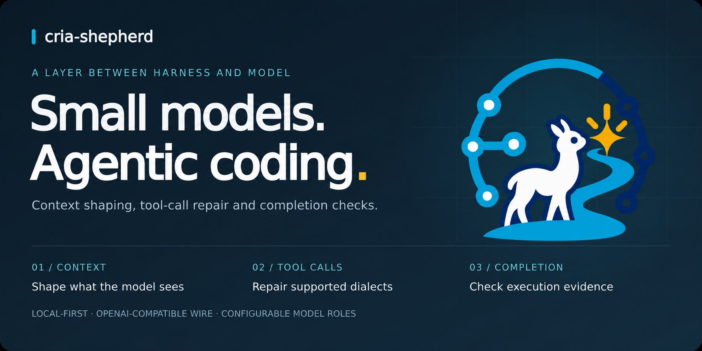
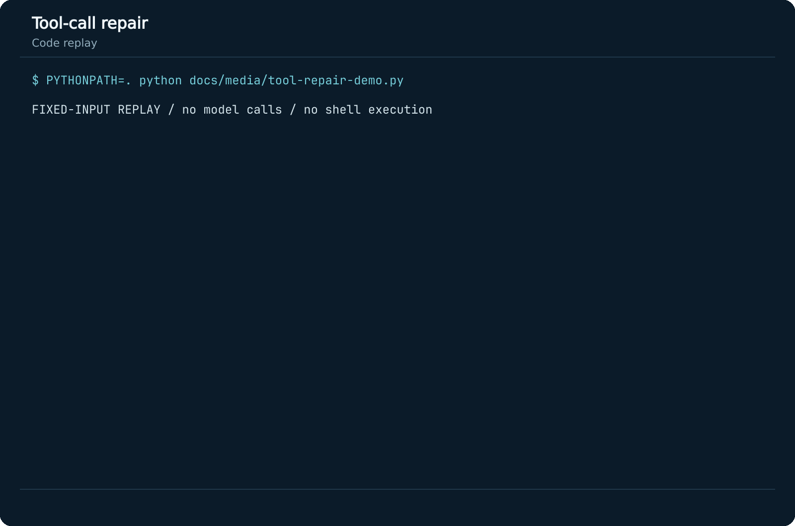
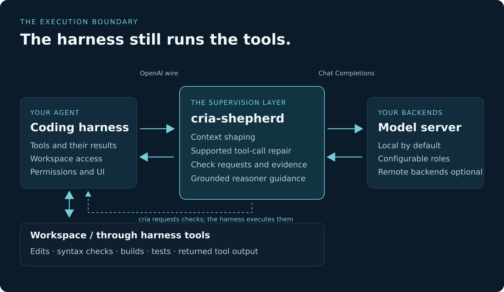
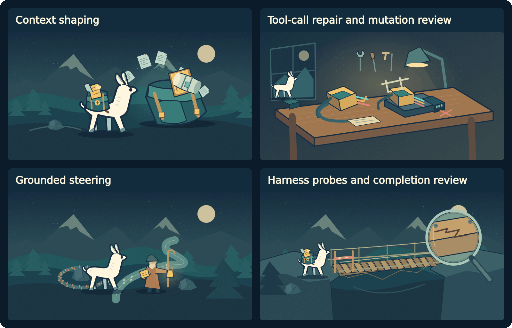
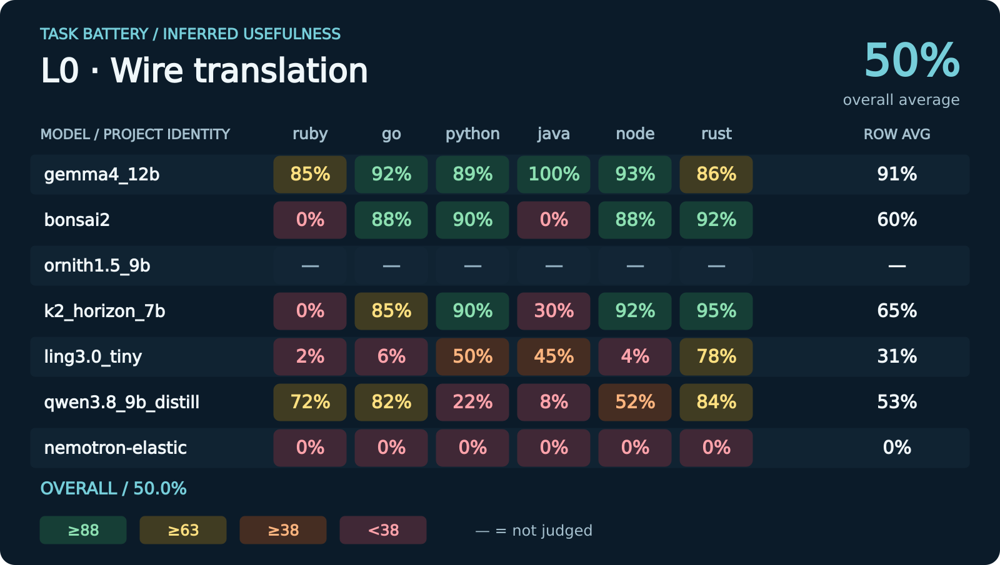
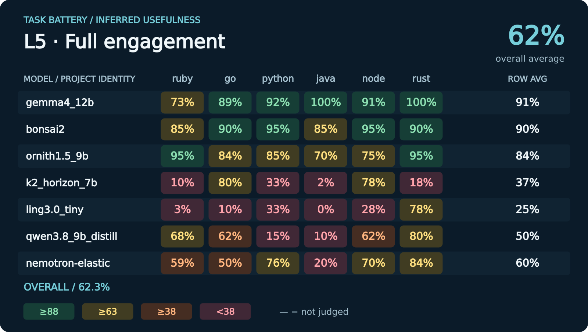

# cria-shepherd

cria-shepherd sits between a coding harness and its model server. It manages context, repairs supported tool-call formats, and requests checks when the agent reports completion.

The harness still runs commands, edits files and controls workspace permissions. cria works on the requests and responses passing between the harness and the model. It supports the OpenAI Chat Completions and Responses APIs, with local models as the default backend. At levels with context preparation, a caller's own instructions (Responses `instructions`/developer items, Chat `system`/`developer` messages) are carried behind cria's coder prompt and reduced with a visible label only when the window requires it; they are never dropped silently. At L0, they are forwarded as sent.

[Tool-call repair](#tool-call-repair) · [Assists](#what-cria-does) · [L0 vs L5](#l0-vs-l5) · [Getting started](#getting-started) · [Explore the docs](docs/README.md)

## Tool-call repair

A tool call can arrive as XML inside `reasoning_content` instead of a structured `tool_calls` entry. cria recovers supported formats and checks the arguments against the tool's schema.

This animation replays a fixed input through the recovery code. The `exec_command` call is recovered, and `yield_time_ms` is converted to an integer. Values that cannot be converted are left unchanged.



## How it fits



The classifier, coder, reasoner and compactor can share a model server or use separate backends. The optional planner is off by default.

## What cria does

Context shaping keeps the original task and current work in view as the conversation grows. Tool repair handles supported call formats, while mutation review checks proposed source changes. When a session gets stuck, cria gathers current workspace evidence for the reasoner. Completion review requests checks through the harness and uses the returned results.



## L0 vs L5

L0 retains proxy/wire and transport-recovery contracts without higher-level coding assistance; L5 enables level-eligible assists. Experimental planning remains separately opt-in. The grids show inferred usefulness across six repository tasks, using the best retained L5 score for each model/task. These historical selections span different revisions and settings, including planner-on runs; they are not a controlled comparison. [How to read the results](docs/methodology.md).





## Getting started

You need Python 3.11+, Git LFS, an OpenAI-compatible model server and a coding harness. System 1 and its CPU runtime are part of the standard installation. Fetch Git LFS objects when cloning; the service refuses to start if the required bundle is missing. System 1 can be disabled explicitly, changing its judgment path. See the [System 1 guide](docs/system1-guide.md).

Optional: install Universal Ctags with interactive sandbox support on the harness host to include multi-language symbols in the initial workspace inventory. Without it, the inventory still lists files and marks symbols unavailable. Binary and invalid UTF-8 files are not indexed; see [inventory details](docs/heuristic-assists.md#context-shaping--what-the-model-sees-and-how-much).

```bash
git clone https://github.com/papag00se/cria-shepherd.git
cd cria-shepherd
python3 -m venv .venv
. .venv/bin/activate
python -m pip install -e .
cp cria.example.toml cria.toml
```

Set `[defaults].base_url` and `[backends.local].base_url` in `cria.toml` to your model server, then start cria:

```bash
python -m cria --config ./cria.toml
```

The example uses a model server at `http://127.0.0.1:18084` and serves cria on port `18085`. Point your harness at `http://127.0.0.1:18085/v1`. For Codex, follow the [setup and context-window instructions](docs/codex-context-window.md).

Large files are read through successive shell calls the harness runs ("multipart reads"). That needs a harness that can execute successive shell calls and return their paired results; multipart state lives under `~/.cria/multipart`, and image state under `${XDG_STATE_HOME:-~/.local/state}/cria/images`. No harness sends a trustworthy session-close signal (measured against real Codex), so **cria deletes nothing by default**: removal is the operator's, through `python -m cria.retention list|prune [--older-than 14d] [--session ID] [--kind multipart|image|snapshot|all] [--apply]` (a dry run unless `--apply`) or the standing instruction `[retention] auto_prune_after = "14d"` (default unset = off). The full contract, including the atomic read snapshot, is in [docs/multipart-and-retention.md](docs/multipart-and-retention.md).

## Configuration

`cria.example.toml` is the annotated reference; every key below is validated at startup (unknown values are errors, not ignored). Layers: with no `--config`, `~/.cria/cria.toml` and then `./cria.toml` are deep-merged (the working-directory file wins); with no file at all, defaults target a llama.cpp server on `:18084`.

- **`[backends.*]`** say WHERE a model runs (`transport = "http"` with an OpenAI-compatible `base_url`, optional `api_key_env`/`model`/`reasoning_style`, or `transport = "cli"` for Claude Code). **`[roles.coder|reasoner|classifier|compactor]`** say HOW cria uses one: backend, sampling, `reasoning = on|off|auto`, and the portability switches `think_protocol`, `collapse_system_prompt` and `merge_consecutive_turns` ([model settings](docs/model-settings.md)). `[failover]` maps a task type to an ordered role chain; a role needing a missing key or binary is skipped.
- **`[engagement]`** defaults to full engagement. Levels 0–5 are internal evaluation controls for comparing mechanisms, not separate products; `bias` determines how an unsure classifier routes a request.
- **Context.** The window is discovered from the server (`[defaults].context_window` pins it only where `/props` cannot be read). Compaction (`[context] self_compact`) has no size knob: *when* it runs is a predicate over the coder's measured window, reserves and recent turn growth, and the removed `trigger_compaction` key is a startup error. Size bounds (caps) are defined at the 49,152-token reference window and scale with the window of the model that answers; an unknown window means the reference value, not a small one. A role's explicit `output_reserve` or `max_tokens` is never rescaled. A caller's own instructions (Responses `instructions`/developer items, Chat `system`/`developer` messages) are carried behind cria's coder prompt (except at level 0, which forwards them as sent).
- **`[retention]`, `[safety] external_dir_permission`** (`none|read|write`, file access outside the workspace, enforced even under `--yolo`), **`[indicators]`** (what cria writes into the visible stream; see [indicators](docs/indicators.md)), **`[tools]`**, **`[logging]`**, **`[system1]`** and **`[planner]`** (OFF; see below) complete the file.
- **`[context]` also carries** `focus_trim`, and for plan-off sessions the periodic whole-task check (`satisfaction_check_start_minutes`, `satisfaction_check_every_minutes`, clamped by `satisfaction_check_min_turns`/`_max_turns`; level 5).

### System 1: our trained decision model

System 1 runs on CPU and helps judge briefings and guidance. Its model ships with cria and is enabled by default; disabling it explicitly changes how those judgments are made. [What it does and how we trained it](docs/system1-guide.md) · [Technical configuration](docs/system1.md).

### Disable individual registered assists

Use `[assists]` in your TOML configuration to opt out of specific registered policies:

```toml
[assists]
disabled = ["schema-argument-conversion", "historical-argument-recovery"]
```

These stable IDs come from the actual [argument-conversion](cria/argumentconversion.py) and [historical-recovery](cria/historyarguments.py) definitions. Omitting this section, or using `disabled = []`, adds no opt-outs; existing engagement levels and applicability still apply. This control cannot enable a policy above its existing level.

`disabled` is an array of strings; optional `profile` defaults to `"default"`. Unknown IDs, duplicate IDs, unknown keys, wrong value types and disabling a dependency of a still-selected policy are configuration errors, not ignored requests. Family labels are not selection IDs. See [`cria/assistfamilies.py`](cria/assistfamilies.py) for the family map; not every legacy family has migrated.

Required wire-validity, privacy and fitting contracts retain their existing applicability independently of optional selections. For example, disabling historical recovery still preserves malformed argument bytes in a valid, lossless envelope. Experimental planning remains OFF by default and requires separate explicit `enabled = true` under `[planner]`; assist selection does not enable it. Developer boundaries are documented in the [architecture contract](docs/shephard.md#assist-and-family-boundaries).

### Exact Rank-4 ablation

```toml
[assists]
profile = "rank4-ablation"

[planner]
enabled = false
```

Assists are **L5 only**. `rank4-ablation` is an exact experimental selection that disables exactly two level-5 definitions, `experimental-step-preparation` and `search-spill-read-judgment` (`RANK4_ABLATION_DISABLED` in `cria/assistprofiles.py`); extra `disabled` entries are rejected. Wire fixes, cria tools, context fitting (including history compaction) and completion brakes at L0–L4 are not assists and stay selected when level-eligible. The profile does not enable planning or change the engagement level. `RANK4_DISABLED` in the same file is the *historical* ranking record of the nine-, seven- and four-disabled runs, which disabled different (and, in the first, 39 non-assist) mechanisms and are not comparable. Outgoing search relevance was deleted, not disabled ([search guidance](docs/search-guidance.md)). Request events record `assist_profile` and the actual selected `pilot_assists`; keep the deployed commit and config with each run receipt, because the profile name alone does not identify a historical selection, and selection is not evidence of usefulness. Changes to this selection need an explicit operator decision.

### Logs and captures

```bash
cria-tail -f           # follow the event log
cria-tail --decisions  # show routing and engagement decisions
```

Enable `[logging].capture_calls = true` to record full calls. Captures include prompts, code and tool results, so check them for secrets before sharing.

### Tests

```bash
python -m pip install pytest
nice -n 19 python -m pytest -q tests            # the whole suite
python -m pytest -q tests/shell_safety         # one domain
python -m pytest tests/structure -q            # structural lints, incl. the generated assist inventory and doc links
```

The ordinary suite uses a fake model server and no GPU or network. Tests are organised by domain under `tests/<domain>/`; run one process at a time. [docs/testing.md](docs/testing.md) covers what a test here must be, how the pre-reset suite is preserved as the git tag `tests-before-reset-20261031`, and how to add a test.

## Documentation

Start with the visual guides to [features](docs/features.md), [how cria works](docs/how-it-works.md), and [how we evaluate it](docs/methodology.md), or browse the [documentation home](docs/README.md).

- [Testing](docs/testing.md): what the suite protects and the rules for changing it
- [Configuration](cria.example.toml) and [model settings](docs/model-settings.md)
- [Multipart reads and retained state](docs/multipart-and-retention.md); [image workflow](docs/image-workflow.md)
- [Dory three-loop runtime, tuning results and qualification limits](docs/dory-runtime.md)
- [Design principles](docs/principles.md) and [assist implementation](docs/heuristic-assists.md)
- [Checks and completion review](docs/participation-evidence.md)
- [Logging and troubleshooting](docs/observability.md)
- [Task battery](docs/task-battery.md)
- [Research lineage and architecture](docs/shephard.md)
- [Offline decision-model data audit and training research](docs/training/README.md)

For contributions, start with [AGENTS.md](AGENTS.md).

A cria is a baby llama. The name comes from the original Shephard research prototype.
