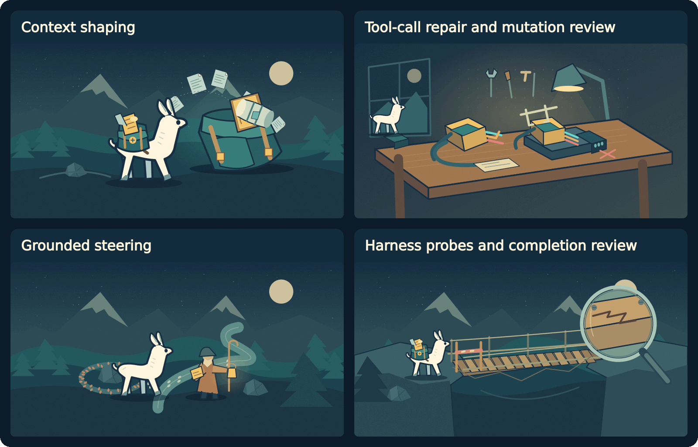

# What cria does

[← Explore](README.md) · [How it works →](how-it-works.md)

Your coding agent is trying to finish a task. cria watches the conversation between the agent and its model and helps at the points where small models often lose their footing.

## Keep the task in view

Long conversations can crowd out the original request or important file contents. cria shapes the context sent to the model and, when the window is tight, labels reductions rather than silently pretending everything is still there.

## Make tool calls usable

A model might put a tool call in the wrong format or supply an argument as text instead of a number. cria repairs supported formats and converts arguments when the tool's schema allows it. The coding harness still decides what it can execute.

## Help when work stalls

If the session gets stuck, cria can gather workspace evidence and ask a reasoner for a grounded next step. The goal is a next step based on what is actually in the workspace.

## Check before accepting “done”

cria can ask the harness to run relevant checks and use their actual output in completion review. A passing check is evidence about what it ran—not proof that every requirement is satisfied. If a judgment cannot be made, cria generally keeps working; bounded exceptions are explained in the [design principles](principles.md).

## Keep the harness in charge

The harness runs commands, edits files, and enforces workspace permissions. cria is a separate OpenAI-compatible layer between that harness and the model; it doesn't replace either one.

**Meet System 1.** cria's small trained CPU model handles two focused decisions about summaries and guidance. [See what it does and how we trained it](system1-guide.md). Experimental planning remains separately opt-in.
