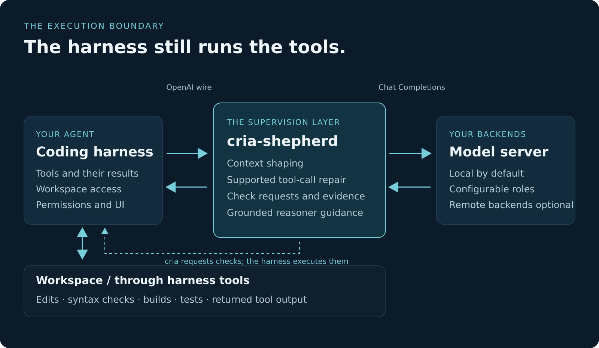
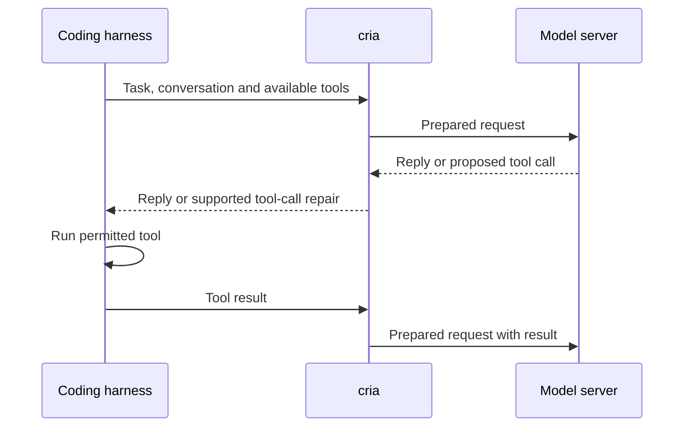
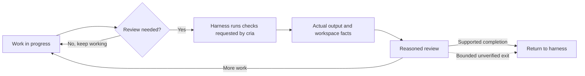

# How cria works

[← Features](features.md) · [Explore](README.md) · [How we evaluate it →](methodology.md)

A **coding harness** is the application you talk to: it manages the session and runs tools. cria sits between it and the model server.

## A typical turn

The model does the coding. cria prepares context and can repair a supported malformed call on its way back. The harness executes the call and returns the result.

## When a check is needed

This is a simplified path: checks depend on the task, available tools and configuration. A failed or incomplete check is not a clean result. Two bounded exits can return without verification: when neither a reasoner nor shell is available, or when the completion-check limit is reached. cria can also review proposed edits and steer a stuck session before a completion claim.

## Different jobs, different roles

A **coder** writes; a **reasoner** weighs evidence; a **classifier** answers narrow routing questions; a **compactor** helps manage long history. They can share one model server or use separate backends. The optional planner is off unless explicitly enabled.

For the detailed contracts, see [architecture](shephard.md), [design principles](principles.md), and [completion evidence](participation-evidence.md).
