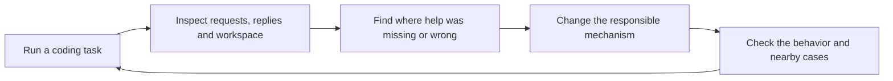

# How we learn what works

[← How it works](how-it-works.md) · [Explore](README.md)

cria is built from observed coding sessions. We inspect what happened, make a focused change, and look for both help and unintended consequences.

## The task battery

The battery uses real repository tasks across languages: fixing tests, adding features, researching dependencies, writing documentation and working with existing code. A **cell** is one model doing one task at one engagement level.

**L0** keeps wire and transport contracts without higher-level coding help. **L5** enables eligible assists. Levels in between help isolate mechanisms; planning is a separate opt-in experiment.

## What the percentage means

A judge inspects the delivered workspace and estimates **how much requested work was usefully written**, including reusable partial work. It is not a test-pass percentage, a count of completed bullets, or the model's own claim. Pre-existing code does not count as work delivered by the model.

During a run, snapshots help a reviewer decide whether to continue. Afterward, the archived workspace receives a separate final judgment. A stopped or incomplete run can still contain useful work.

## How to read the grids

The README's L0 and L5 grids are **historical selections**, not a controlled head-to-head experiment. The L5 grid takes the best retained score per model/task across runs with different revisions and settings, including planner experiments; it does not establish typical performance or the causal lift from L5. Some captures are unavailable.

For current standing results and their provenance, see the [battery report](battery-report.md), [task battery](task-battery.md), and [media data notes](media/README.md#battery-data). For the different methodology used to train optional decision models, see [training research](training/methodology.md).

## What a replay means

A focused **model replay** reconstructs a captured request through the cria change being examined, sends it to the model, and compares the reply with an appropriate control. It can investigate a specific intervention but doesn't by itself prove that a full task improves. The README's tool-repair animation is different: it replays fixed input through code without a model.
