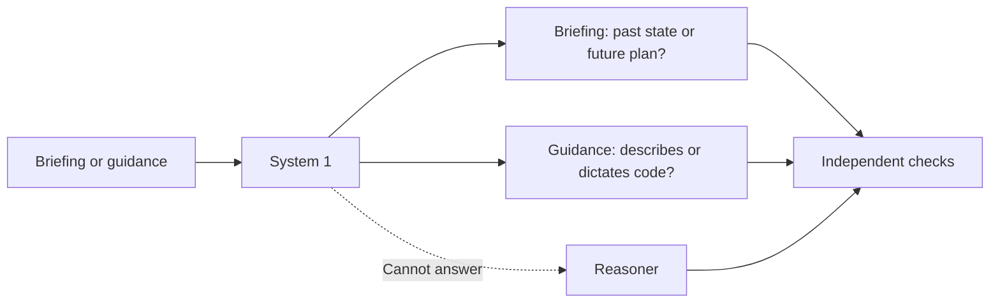
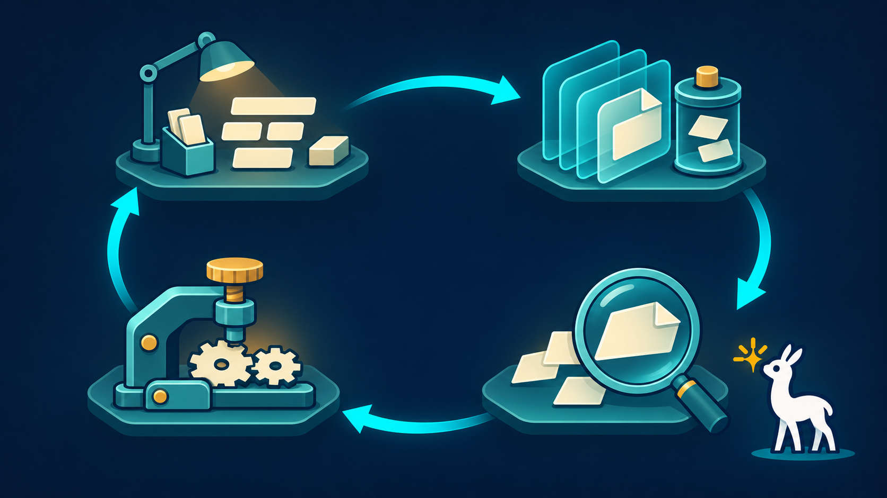

# System 1: quick judgments, grounded guidance

[← Explore](README.md) · [How cria works](how-it-works.md) · [How we learn](methodology.md)

cria uses a small model we trained for two focused decisions. It runs locally on the CPU, alongside the coding model—not in place of it.

System 1 helps keep a session summary retrospective and prevents guidance from prescribing unverified code. It does **not** decide whether the whole task is complete. Other checks remain independent.

## How we trained it

We fine-tuned a pretrained classifier using real coding-session examples and separately authored synthetic examples. Independent reviewers checked the labels. We reserved a synthetic challenge set for evaluation, then exported and compressed the model for CPU inference. That challenge is useful evidence—not a guarantee of performance on new real sessions.

## Getting it running

System 1 is enabled by default. On first start, cria automatically installs its trained model into its own model directory; a compatible replacement can be selected with `[system1].bundle_dir`. **Publication of the standard bundle is pending approval**, so automatic delivery will become available after the release asset is published. See the [technical reference](system1.md) for startup behavior.

For the full research record, see [training methodology](training/methodology.md). For the service implementation, see [System 1 serving](system1.md).
